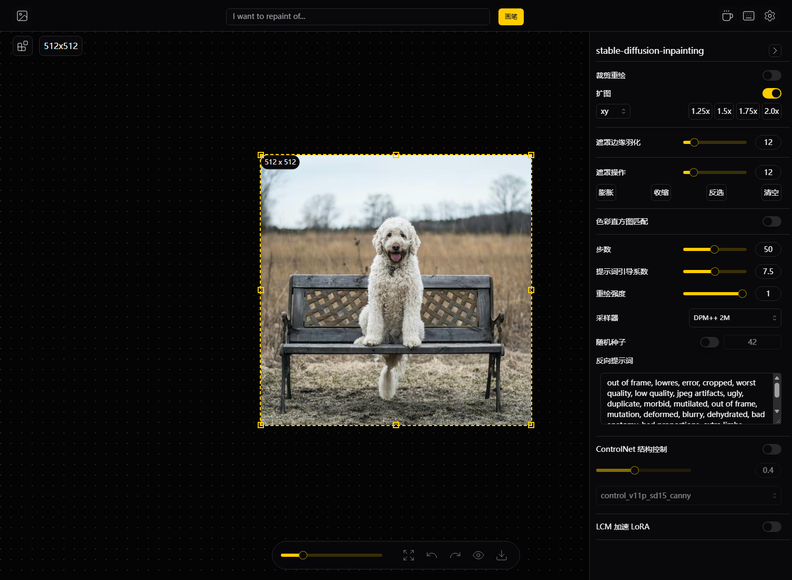
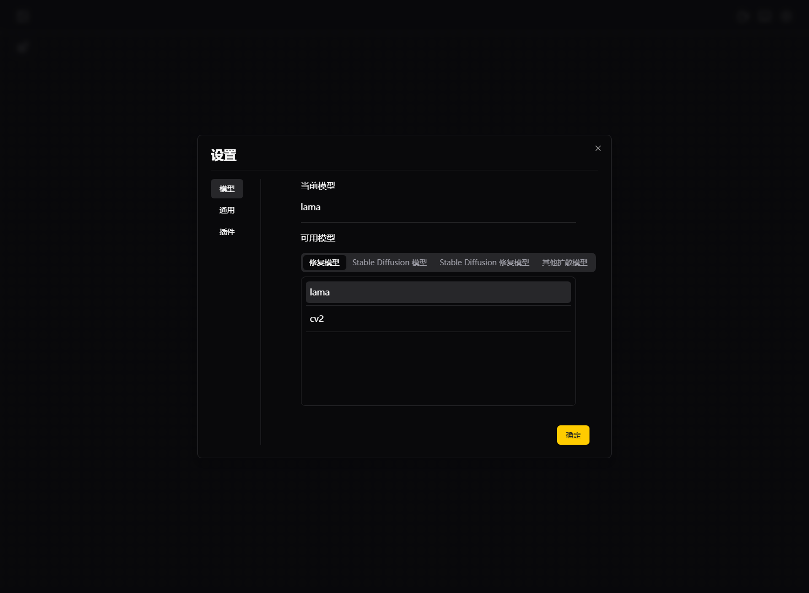
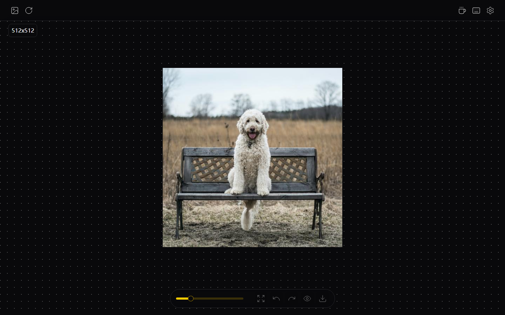
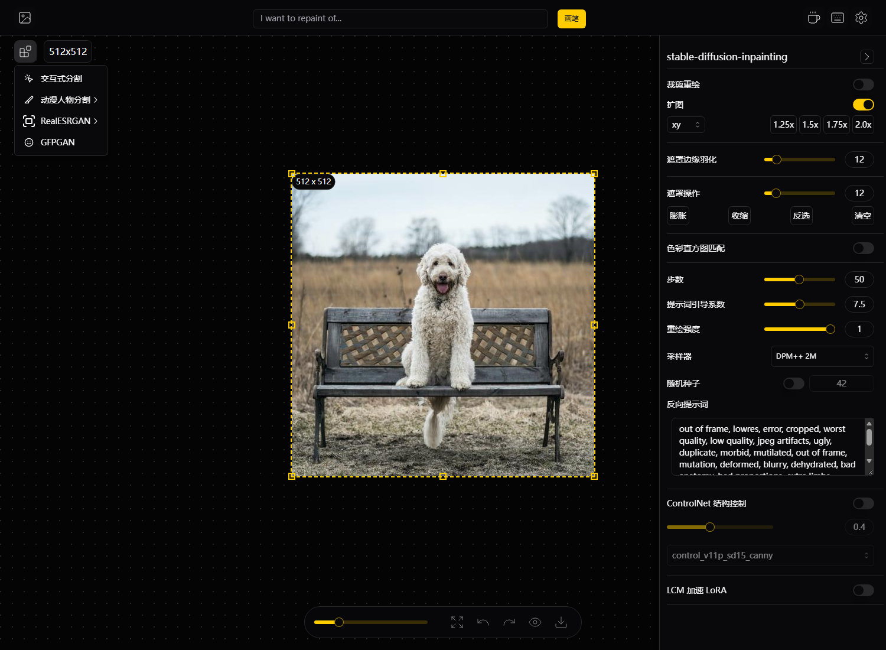

# IOPaint 简体中文汉化补丁 (zh-CN)

给 [IOPaint](https://github.com/Sanster/IOPaint) 1.6.0 的 WebUI 加上简体中文界面。
**不修改原打包文件、不改动后端逻辑**，通过运行时 DOM 翻译层实现，可一键还原。

## 为什么不用改源码
IOPaint 前端是 Vite 打包的单页应用（`iopaint/web_app/assets/index-*.js`），
源码里**没有任何 i18n 框架**，所有文案都硬编码在 21 个 TSX 组件中。
上游唯一的本地化请求（issue #307）被 stale 机器人自动关闭，从未实现；
GitHub 上也**不存在任何第三方汉化项目**（repo 搜索结果为 0）。

本补丁的做法：注入一个独立 JS，监听 DOM，把界面文本/占位符/提示替换为中文；
React 重渲染后自动重贴，因此不用重新编译前端，也不会在升级时引入冲突。

## 效果截图

| 扩散模型侧栏 | 设置 · 模型 | 首页 |
|---|---|---|
|  |  |  |

插件菜单（已汉化）：



## 两种安装方式

### 方式一：直接用整合包（不想折腾环境就选这个）

解压即用，与 Python 环境完全隔离，**已内置中文界面和全部模型，断网可用**。

| 版本 | 压缩包 | 解压后 | 内置内容 | 下载 |
|---|---|---|---|---|
| **精简版 B** | 3.86 GB | 4.00 GB | IOPaint 1.6.0（汉化）+ LaMa 擦除 + RealESRGAN 超分 + GFPGAN / RestoreFormer 人脸修复 + AnimeSeg 动漫分割 + SAM2.1 点选分割 | 【网盘链接-待填】提取码【待填】 |
| **完整版 C** | 6.22 GB | 6.55 GB | 精简版全部 + **Stable Diffusion 1.5 inpainting**（换物体 / 扩图） | 【网盘链接-待填】提取码【待填】 |

文件名与校验值（下载后请核对，防止网盘传输损坏）：

| 文件 | SHA-256 |
|---|---|
| `IOPaint-zh-portable-B-v1.0.zip` | `8a743e2469463f82a7baa9f910e7442d93641302d9c818c713faac8797452e0c` |
| `IOPaint-zh-portable-C-v1.0.zip` | `3531bb992091433414f577d765bfaa1a3301398dea19b3e684cb0ec5eb714bbd` |

校验方法（Windows 自带 certutil，把文件名换成你的）：

```cmd
certutil -hashfile IOPaint-zh-portable-B-v1.0.zip SHA256
```

使用步骤：

1. 下载后解压到**纯英文、无空格**的路径（例如 `D:\IOPaint-zh`）——中文路径会导致模型加载失败
2. 双击 `启动 IOPaint（擦除增强）.bat`（换物体/扩图请用 `启动 IOPaint（SD 换物·扩图）.bat`）
3. 浏览器自动打开 http://127.0.0.1:8080
4. 显卡需 NVIDIA（8GB 显存即可流畅；6GB 建议只用擦除模式）；无独显可把脚本里 `--device cuda` 改成 `--device cpu`

整合包内附 `VERSION.txt`（记录版本构成）；SHA-256 见上表。遇到闪退多为缺 VC 运行库：
<https://aka.ms/vs/17/release/vc_redist.x64.exe>

> 整合包只是把官方 PyPI 包、公开模型权重和本汉化补丁打包在一起，未修改模型权重；
> 各模型权重遵循其原始许可（LaMa / GFPGAN / RealESRGAN / SAM2 / SD1.5）。

### 方式二：只打汉化补丁（已有 IOPaint 环境）

## 安装
```bash
# 用「装了 iopaint 的那个 Python」执行（venv 里的 python.exe 或系统 python）
python apply.py
# 然后刷新浏览器（Ctrl+F5）即可
```

## 检查 / 卸载
```bash
python apply.py --check      # 查看当前状态
python apply.py --uninstall  # 还原英文原版
```

## 升级 iopaint 后
`pip install -U iopaint` 会覆盖 `web_app`，重新执行一次 `apply.py` 即可。
（若上游将来支持 i18n，本补丁可直接卸载，无残留。）

## 目录说明
| 文件 | 作用 |
|---|---|
| `zh-CN.js` | 汉化引擎 + 词表（唯一需要维护的文件） |
| `zh-CN.dict.json` | 纯词表，便于校对/贡献 |
| `apply.py` | 安装 / 卸载 / 检查 |

## 覆盖情况（已在真实浏览器中逐屏验证）

| 界面 | 状态 |
|---|---|
| 首页 / 拖拽上传 / 文件选择 | ✅ |
| 编辑器工具栏（画笔、撤销重做、原图对比、保存、复制、修复按钮） | ✅ |
| 设置 · 模型页（当前模型、可用模型、四类分组） | ✅ |
| 设置 · 通用页（手动修复、下载遮罩、自动提取提示词及说明） | ✅ |
| 设置 · 插件页（抠图 / 超分 / 交互式分割及各自模型选择） | ✅ |
| 快捷键说明对话框（全部 15 项） | ✅ |
| 扩散模型侧栏（裁剪重绘、扩图、遮罩羽化、遮罩操作膨胀/收缩/反选/清空、直方图匹配、步数、引导、强度、采样器、种子、反向提示词、BrushNet、PowerPaint 任务、ControlNet、LCM） | ✅ |
| OpenCV(cv2) 侧栏 / LDM 侧栏 | ✅ |
| 文件管理器（目录切换、排序、布局、搜索） | ✅ |
| 交互式分割确认框（取消 / 确认）、toast 提示 | ✅ |
| **插件下拉菜单**（交互式分割 / 动漫人物分割 / RealESRGAN / GFPGAN，子菜单：放大 2 倍 / 放大 4 倍 / 抠图 / 去背景 / 生成遮罩） | ✅ |
| **真实扩散模型面板**（SD1.5 实机渲染，含 ControlNet 选区） | ✅ |

**159 条词条已用「逐条注入 DOM 比对」方式全量回归：159/159 生效，0 条失效。**
**9 条动态消息正则（插件运行完成、模型切换、遮罩尺寸不符、图片数量等）逐条验证通过。**
复核环境：Windows 11 + NVIDIA 8GB 显存显卡 + IOPaint 1.6.0，分别在「擦除模型」「SD1.5 真实推理」「5 个插件全开」「目录模式」四种实机上逐屏抓取渲染文本，**残留英文 0 条**（模型 ID / 采样器名 / 品牌名除外）。
（注意：BrushNet/ControlNet 的子选项面板需后端开启对应能力才会出现，其文案已预先录入并在引擎层验证通过。）

## 技术要点
- 精确匹配词表 + 正则规则（处理含变量的句子，如 `Run xxx successfully in 1.4s`）
- MutationObserver 监听 `childList / characterData / attributes`，覆盖 Radix 的 Portal 弹层与 toast
- 跳过 `SCRIPT/STYLE/CODE/PRE/KBD/TEXTAREA`，不改 `input.value`（只改 placeholder），保证上传/参数提交不受影响
- 已含中文的节点不再二次处理，避免死循环

## 许可
词表与引擎为本项目原创，随 IOPaint 本体一同按 Apache-2.0 使用。
